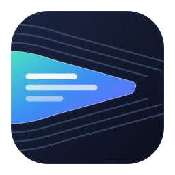
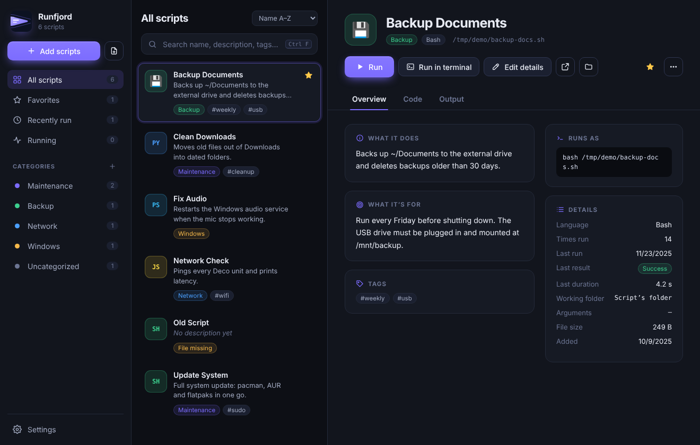
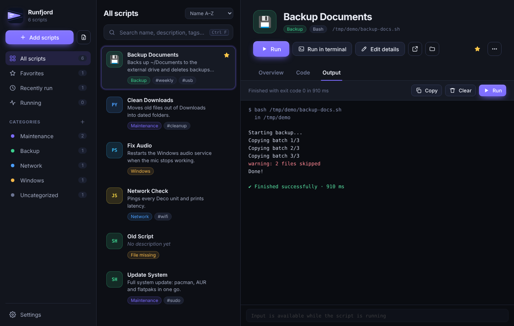
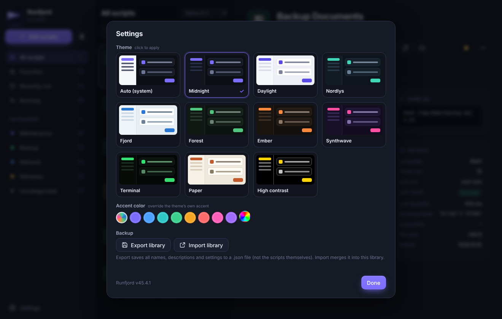

<p align="center">
  
</p>

<h1 align="center">Runfjord</h1>

<p align="center">
  <b>Every script. Explained. One click away.</b><br>
  A desktop app that keeps all your scripts in one library — with a note on what each one does and what it's for — and runs them with one click.
</p>

<p align="center">
  
  
  
</p>

<p align="center">
  
</p>

## Features

- **One library for all your scripts** — add them with a button, <kbd>Ctrl</kbd>+<kbd>N</kbd>, or by dragging files onto the window.
- **Finds the scripts you already have** — one click searches your usual folders (`~/bin`, `~/.local/bin`, `~/scripts`, Documents, Desktop, Downloads, or any folder you pick), skips program, system and hidden folders, and sorts what it finds into categories by language or folder. You tick which ones to add.
- **Never forget what a script does** — every script gets a *What it does* and a *What it's for* note. Descriptions are read automatically from the comment at the top of the file.
- **Run with one click** — live output (errors in red), send input, stop at any time. *Run in terminal* for scripts that need `sudo` or ask questions.
- **Organise** — categories (drag cards onto them), tags, favourites, icons, search and sorting.
- **Built-in code editor** and templates for new scripts (Bash, Python, JavaScript, PowerShell, Batch, Fish).
- **Runs almost anything** — `.sh` `.bash` `.zsh` `.fish` `.py` `.js` `.ts` `.ps1` `.bat` `.cmd` `.rb` `.pl` `.lua` `.php` and any executable, or set your own command (e.g. `sudo bash {file}`).
- **10 themes** — Midnight, Daylight, Nordlys, Fjord, Forest, Ember, Synthwave, Terminal, Paper and High contrast — plus *Auto* and any accent colour.
- **35 languages** — picked automatically from your computer's language, with full right-to-left layout for Arabic, Hebrew and Persian.
- **Your data stays yours** — no account, no network access, no telemetry. Export/import your library as a `.json` backup.

<p align="center">
  
  
</p>

## Download

### Arch / CachyOS / Manjaro — one command

```bash
curl -fLo /tmp/runfjord.pkg.tar.xz https://github.com/LastJaegerVA/runfjord/releases/latest/download/runfjord-x86_64.pkg.tar.xz && sudo pacman -U /tmp/runfjord.pkg.tar.xz
```

Downloads the newest package and installs it with pacman, so it shows up in your app menu. (It downloads first because pacman refuses unsigned packages given as a web link.) To update later, run the same command again.
Remove it with `sudo pacman -R runfjord`.

### Any Linux — one command

```bash
curl -fsSL https://raw.githubusercontent.com/LastJaegerVA/runfjord/main/install.sh | bash
```

It downloads the newest release, installs it for your user (no password needed) and adds Runfjord to your app menu.
Run the same command again to update. To remove Runfjord:

```bash
curl -fsSL https://raw.githubusercontent.com/LastJaegerVA/runfjord/main/install.sh | bash -s -- --uninstall
```

### Download the file and install it yourself

Get the latest version from the [**Releases**](../../releases/latest) page.

| System | File | How to install |
|---|---|---|
| **Windows 10/11** | `Runfjord-Setup-x.y.z.exe` | Run it. Installs for your user (no admin rights needed), adds Start menu and desktop shortcuts, and can be removed from *Settings → Apps*. |
| **Arch / CachyOS / Manjaro** | `runfjord-x86_64.pkg.tar.xz` | In the folder you saved it to: `sudo pacman -U runfjord-x86_64.pkg.tar.xz`. Adds Runfjord to your app menu; remove with `sudo pacman -R runfjord`. |
| **Any Linux** (x86-64) | `Runfjord-x.y.z-x86_64.AppImage` | Use the command above, or `chmod +x Runfjord-*.AppImage` and double-click it. Works on most distributions (Arch/CachyOS, Ubuntu, Fedora, …). |

> **Windows SmartScreen** may warn the first time, because the installer isn't code-signed. Click **More info → Run anyway**.

Your library is stored in `%APPDATA%\Runfjord\library.json` (Windows) or `~/.config/Runfjord/library.json` (Linux). Uninstalling keeps it.

## Languages

English · العربية · Български · বাংলা · Čeština · Dansk · Deutsch · Ελληνικά · Español · فارسی · Suomi · Français · עברית · हिन्दी · Hrvatski · Magyar · Bahasa Indonesia · Italiano · 日本語 · 한국어 · Bahasa Melayu · Norsk · Nederlands · Polski · Português · Română · Русский · Svenska · Kiswahili · ไทย · Türkçe · Українська · Tiếng Việt · 简体中文 · 繁體中文

Runfjord follows your computer's language automatically; change it any time in **Settings → Language**.
Spotted a mistake in your language? See [CONTRIBUTING.md](CONTRIBUTING.md) — fixes are very welcome.

## Keyboard shortcuts

| Shortcut | Action |
|---|---|
| <kbd>Ctrl</kbd>+<kbd>N</kbd> | Add scripts |
| <kbd>Ctrl</kbd>+<kbd>Shift</kbd>+<kbd>N</kbd> | Create a new script |
| <kbd>Ctrl</kbd>+<kbd>F</kbd> | Search |
| <kbd>Ctrl</kbd>+<kbd>Enter</kbd> / <kbd>F5</kbd> | Run (or stop) the selected script |
| <kbd>Ctrl</kbd>+<kbd>E</kbd> | Edit details |
| <kbd>Ctrl</kbd>+<kbd>S</kbd> | Save code |
| <kbd>Ctrl</kbd>+<kbd>T</kbd> | Switch theme |
| <kbd>↑</kbd> <kbd>↓</kbd> | Move through the list |
| <kbd>Del</kbd> | Remove from library (the file stays on disk) |

## Build from source

Requires [Node.js](https://nodejs.org/) 20 or newer.

```bash
npm install
npm start                # run in development
npm run check            # verify every translation is complete
npm run dist:linux       # build the AppImage and the Arch package into dist/
npm run dist:win         # build the Windows app folder into dist/win-unpacked
```

Publishing a release is automatic: raise `version` in `package.json` and push to `main`.

The Windows installer is made with [NSIS](https://nsis.sourceforge.io/) from `installer/runfjord.nsi`:

```bash
npm run dist:win
node tools/gen-installer-langs.js
makensis /DVERSION=1.4.3 installer/runfjord.nsi   # → dist/Runfjord-Setup-1.4.3.exe
```

Pushing a tag like `v1.4.0` runs the [release workflow](.github/workflows/release.yml), which builds both downloads on GitHub and attaches them to a new release.

## Project layout

```
main.js                 Electron main process: storage, running scripts, dialogs
preload.js              Safe bridge between the window and the main process
renderer/               The interface (HTML, CSS, JS)
renderer/i18n.js        Translation core (plurals, right-to-left, language detection)
renderer/locales/       One file per language
installer/              Windows installer (NSIS)
tools/                  Translation checker and installer-language generator
build/                  App icons
```

## License

Copyright © 2026 Jonas Olsen-Sund ([LastJaegerVA](https://github.com/LastJaegerVA)). Runfjord is free and open source under the [MIT License](LICENSE):
anyone may use, change and share it, as long as they keep this copyright notice.
It is built with Electron and other open-source software; see [THIRD_PARTY_NOTICES.md](THIRD_PARTY_NOTICES.md).
